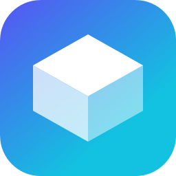

<div align="center">



# AliCraftLauncher

**个人自用的 Minecraft 启动器**

在开源项目 [Plain Craft Launcher 2 (PCL2)](https://github.com/Meloong-Git/PCL) 的基础上二次开发

</div>

---

## 关于本项目

AliCraftLauncher 是一个**个人自用**的 Minecraft 启动器，基于 **Plain Craft Launcher 2** 的开源代码进行了品牌化与功能调整，并使用全新的自绘 LOGO 与界面设计。

> ### 原始出处与版权声明（重要）
> 本项目的核心代码来自 **Plain Craft Launcher (PCL)**，版权归原作者 **龙腾猫跃（LTCat）** 及 PCL 社区贡献者所有，本项目仅在此基础上进行个人化的二次开发。
>
> - 上游仓库：https://github.com/Meloong-Git/PCL
> - 帮助文档库：https://github.com/LTCatt/PCL2Help
> - 许可协议：见仓库根目录 [LICENCE](LICENCE)，二次开发同样遵循该协议
>
> 感谢原作者与社区的无私开源，本项目才能得以完成。

## 本分支的主要改动

| 改动 | 说明 |
| --- | --- |
| 品牌更名 | 程序名 / 图标 / 标题栏 / 界面统一为 AliCraftLauncher，采用全新自绘 LOGO |
| 恢复下载 | 恢复 Minecraft 原版下载与整合包导入功能 |
| 精简内容 | 移除赞助 / 会员 / 土豆码 / 主题解锁等与个人使用无关的内容 |
| 界面重设计 | 重新设计界面外观，参考现代启动器的设计语言 |
| 正版登录 | 使用自建的 Azure 应用完成微软账号登录 |

## 功能特性

- 版本下载与安装：原版、Forge、NeoForge、Fabric、LiteLoader、OptiFine
- 整合包导入：CurseForge / Modrinth / 压缩包
- 资源搜索与下载：CurseForge / Modrinth（内置中文名搜索）
- 版本管理、模组管理、Java 管理与自动获取
- 多账号、离线登录 / 微软正版登录
- 多线程分片下载、断点续传、镜像源加速

## 构建

需要 **Visual Studio 2022**（含 .NET Framework 4.8 目标包）与 **.NET SDK**。

```powershell
git clone --recursive https://github.com/jxy162/PCL.git
cd PCL
dotnet restore PCLCS\PCLCS.csproj
& "C:\Program Files\Microsoft Visual Studio\2022\Community\MSBuild\Current\Bin\MSBuild.exe" `
    "AliCraftLauncher\AliCraftLauncher.vbproj" -p:Configuration=Release
```

产物路径：`AliCraftLauncher\bin\AliCraftLauncher.exe`

## 目录结构

| 目录 | 说明 |
| --- | --- |
| `AliCraftLauncher/` | 主程序（VB.NET + WPF） |
| `PCLCS/` | 启动核心与通用能力（C#） |
| `MeloongCore/` | 通用库（子模块，C#） |
| `Assets/` | 品牌资源（LOGO 等） |

## 鸣谢

- **龙腾猫跃（LTCat）** 与 PCL 社区：提供了 Plain Craft Launcher 这一优秀的开源项目
- **bangbang93**：BMCLAPI 镜像源与 Forge 安装工具
- **MC 百科 / MCIM / EasyTier** 等社区伙伴